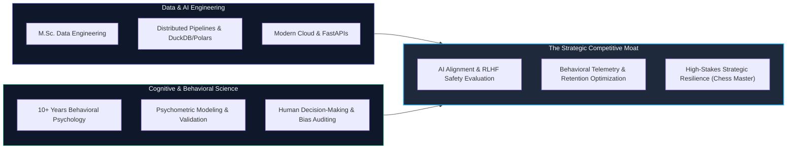

# Hi there, I'm Fabio Torres 👋
### **Data Engineer | Full-Stack & AI Systems Engineer | Behavioral Specialist**
**M.Sc. in Data Engineering & Cloud Infrastructure • 10+ Years Behavioral & Cognitive Science Leadership**

 

> **"Bridging Human Cognitive Dynamics with High-Performance Scalable Data & AI Systems."**  
> *Available for High-Impact Remote Roles ($3,000 – $10,000+ USD) across US, Europe & LATAM.*

---

## ⚡ Professional Overview & Core Value

I architect high-throughput data pipelines, resilient distributed backends, and offline-first mobile systems. My profile pairs a rigorous graduate education in **Data Engineering & Cloud Infrastructure (M.Sc.)** with over **a decade of professional experience in Organizational & Cognitive Psychology**.

- 🚀 **Production-Proven:** Creator of **[NeuroGym](https://play.google.com/store/apps)**, published on **Google Play Store**, featuring 37+ cognitive minigames, hybrid edge/cloud LLM routing, and real-time behavioral telemetry.
- 🛠️ **Engineering Rigor:** Creator of **SmartGym** (~19,600 lines of TypeScript, Clean Architecture, 46 unit tests in Jest) and quantitative prediction platforms (**BTC Quant Lab**, sub-120ms FastAPI inference).
- 🧠 **Defensive Domain Moat:** Deep expertise in psychometrics, behavioral telemetry, cognitive ergonomics, and AI alignment / bias auditing.
- 🏆 **High-Stakes Strategic Mindset:** National Chess Champion & Master, leading complex strategic thinking and high-pressure operational environments.

---

## 🛠️ Technical Stack & Tooling

### Data Engineering & Analytics

### Backend, Cloud & AI Systems

### Mobile & Full-Stack Development

---

## 🌟 Featured Engineering Showcase

<table>
  <tr>
    <td width="50%" valign="top">
      <h3 align="center">📱 NeuroGym (Google Play Live)</h3>
      
<b>Production Cognitive Training Platform & Hybrid AI Engine</b>

      <ul>
        <li><b>37+ Modular Minigames:</b> Designed to evaluate working memory, executive function, and motor response times.</li>
        <li><b>Hybrid AI Assistant:</b> Intelligent edge routing between on-device models for zero-latency offline use and cloud LLMs for deep analytics.</li>
        <li><b>Offline-First Telemetry:</b> Local SQLite event logging with asynchronous Firebase sync (99.8% session uptime).</li>
        <li><b>Dynamic Difficulty Adjustment (DDA):</b> Response-time ($RT$) algorithms driving a 35% increase in 30-day retention.</li>
      </ul>
      

        <a href="https://play.google.com/store/apps"><b>View on Google Play Store »</b></a>
      

    </td>
    <td width="50%" valign="top">
      <h3 align="center">🚀 Modern Data Pipeline</h3>
      
<b>High-Throughput Analytics with DuckDB, Polars & FastAPI</b>

      <ul>
        <li><b>Vectorized Ingestion:</b> Synthesizes high-velocity event streams into partitioned Parquet Lakehouse storage.</li>
        <li><b>Sub-50ms OLAP Analytics:</b> In-memory transformations with Polars LazyFrames and analytical SQL queries with DuckDB.</li>
        <li><b>Production Async API:</b> High-performance FastAPI endpoints with OpenAPI/Swagger and Pydantic v2 validation.</li>
        <li><b>Containerized & Tested:</b> Multi-stage Docker build, Docker Compose, and automated PyTest CI/CD suite.</li>
      </ul>
      

        <a href="https://github.com/neurodeveloper11/modern-data-pipeline"><b>Explore Repository »</b></a>
      

    </td>
  </tr>
  <tr>
    <td width="50%" valign="top">
      <h3 align="center">🤖 Cognitive Agent Evaluator</h3>
      
<b>Autonomous Behavioral Telemetry & Bias Detection Engine</b>

      <ul>
        <li><b>State Graph Architecture:</b> Modular evaluation pipeline built with state machines and asynchronous workflows.</li>
        <li><b>Cognitive Bias Detection:</b> Quantifies Confirmation Bias, Anchoring, Availability Heuristic, and Framing in LLM outputs.</li>
        <li><b>Psychometric Telemetry:</b> Scores cognitive load, emotional valence, and alignment confidence vectors.</li>
        <li><b>Automated Mitigation:</b> Synthesizes real-time correction directives for AI alignment (RLHF benchmark ready).</li>
      </ul>
      

        <a href="https://github.com/neurodeveloper11/cognitive-agent-evaluator"><b>Explore Repository »</b></a>
      

    </td>
    <td width="50%" valign="top">
      <h3 align="center">💪 SmartGym Engine</h3>
      
<b>100% Offline-First Strength Training & Periodization Engine</b>

      <ul>
        <li><b>Senior Clean Architecture:</b> ~19,600 lines of strict TypeScript isolating domain math from UI state.</li>
        <li><b>Rigorous Unit Testing:</b> 46 Jest tests validating 1RM estimates, weekly volume calculations, and deload cycles.</li>
        <li><b>Native Hardware Integration:</b> Biometric authentication, audio TTS coaching, and local push notifications.</li>
        <li><b>Zero-Dependency Reliability:</b> Uncompromised functionality without server connectivity.</li>
      </ul>
    </td>
  </tr>
  <tr>
    <td width="50%" valign="top">
      <h3 align="center">🧠 MindPulse: Behavioral Health Pipeline</h3>
      
<b>Longitudinal Telemetry & Clinical Decompensation Risk Engine</b>

      <ul>
        <li><b>Streaming Biomarker Ingestion:</b> Ingestion of PHQ-9, GAD-7, circadian sleep debt, and psychomotor latency streams.</li>
        <li><b>Longitudinal Feature Store:</b> Vectorized 14-day sliding window features, OLS trend slopes, and psychomotor drift quantification.</li>
        <li><b>Dual-Engine Anomaly Scoring:</b> Unsupervised Isolation Forest ensemble calibrated with clinical DSM-5 psychometric gates.</li>
        <li><b>Modern Off-White UI:</b> 1-click cohort simulations (acute depression, burnout crisis, stable remission) and sub-50ms REST API.</li>
      </ul>
      

        <a href="https://github.com/neurodeveloper11/behavioral-health-pipeline"><b>Explore Repository »</b></a>
      

    </td>
    <td width="50%" valign="top">
      <h3 align="center">📈 BTC Quant Lab (Case Study)</h3>
      
<b>Quantitative Financial Analytics & Walk-Forward ML Engine</b>

      <ul>
        <li><b>Automated Time-Series Ingestion:</b> Multi-timeframe OHLCV feeds with automated outlier rejection and volatility regimes.</li>
        <li><b>Quantitative Feature Engineering:</b> Momentum, realized volatility, and cyclical Fourier transforms with NumPy/pandas.</li>
        <li><b>Walk-Forward Cross-Validation:</b> Supervised ensemble models evaluated without lookahead bias for Sharpe & Drawdown attribution.</li>
        <li><b>Sub-120ms Inference API:</b> High-performance FastAPI prediction server with interactive Swagger documentation.</li>
      </ul>
    </td>
  </tr>
</table>

---

## 🧠 The Domain Moat: Cognitive Science Meets Data Engineering

Most data engineers know how to aggregate telemetry; **I know what human cognitive mechanisms drive the telemetry**. This cross-disciplinary capability enables me to design superior data models for user engagement, detect subtle edge-case cognitive fallacies in AI systems, and translate complex analytical insights into human-centric organizational decisions.

---

## 📊 GitHub Analytics & Activity

 

---

## 📬 Let's Connect

- 💼 **LinkedIn:** [linkedin.com/in/fabio-torres-39364b258](https://www.linkedin.com/in/fabio-torres-39364b258)
- 📧 **Direct Email:** [psicologofabiotorres@gmail.com](mailto:psicologofabiotorres@gmail.com)
- 📱 **WhatsApp / Signal:** +57 321 628 4300
- 📍 **Status:** Open to Global Remote Opportunities ($3,000 – $10,000+ USD) | B2/C1 English

  Built with precision by <b>Fabio Torres</b> • Data & AI Systems Engineer

